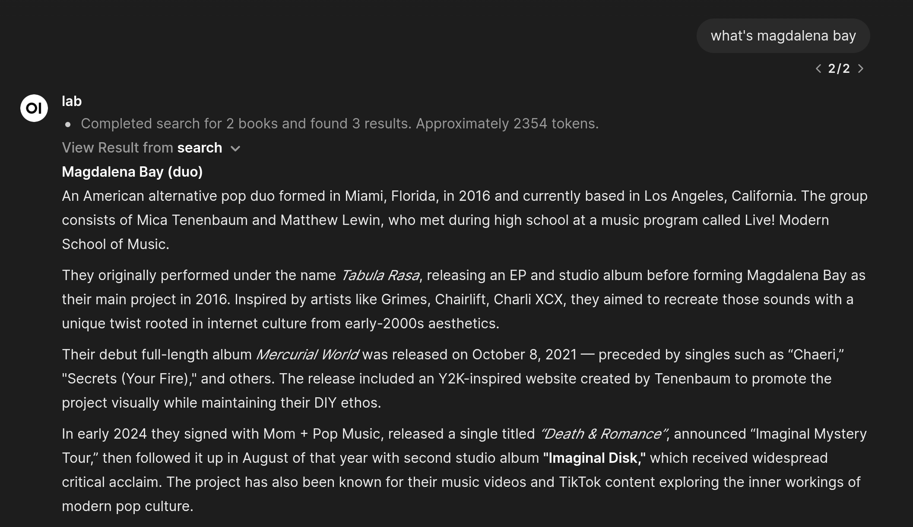

# Kiwix-Search-OpenWebui
Search through a Kiwix server with openwebui.

This tool allows chatbot to search through a Kiwix server. Needs to configure the URL endpoint and books to search in valves first. Installation of BeautifulSoup4 is required on your hosting server. 

FYI [Kiwix-serve](https://wiki.kiwix.org/wiki/Kiwix-serve) is a tool that allows you to host a local offline version of wikipedia and other websites(called "books"). 

- Books that can be downloaded: [browse.library.kiwix.org](https://browse.library.kiwix.org/#lang=&q=). 

- Latest English wikipedia: [wikipedia_en_all_maxi_2026-08.zim (119gb)](https://lb.download.kiwix.org/zim/wikipedia/wikipedia_en_all_maxi_2026-08.zim).

PS. OpenWebUI has this weird behavior of including tool output twice in prompt, set `Function Calling` to `Native` to avoid this problem and save tokens.

[Kiwix Search Tool • Open WebUI Community](https://openwebui.com/t/kanzo/kiwix_search)
